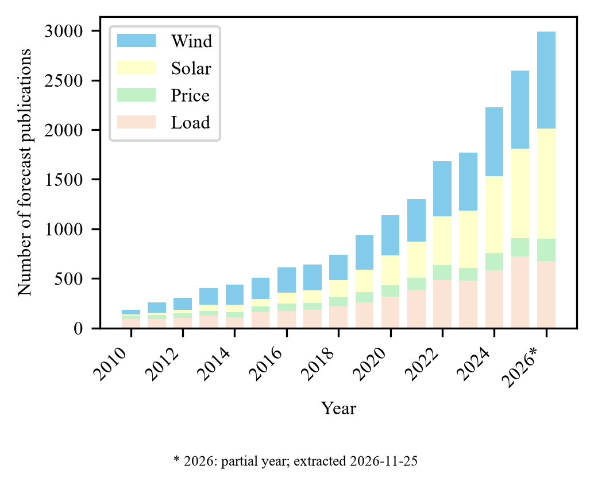

# Figure 1 (EEM paper 2026): Scopus publication counts

Reproducible Scopus counts for load, price, wind and solar forecasting, **2010-2026**.
The maintained dataset uses **query option 6**, unchanged from the previous snapshot.



## Current snapshot

Extracted **25 November 2026**. **2026 is a partial year**: these are records indexed by Scopus at extraction, not a full-year projection. Earlier years were refreshed in the same extraction, so indexing corrections can change historical counts.

| Domain | 2026 indexed publications |
| --- | ---: |
| Load | 676 |
| Price | 224 |
| Wind | 980 |
| Solar | 1,110 |

Each domain is searched independently. A publication can match multiple domains, so the stacked sum is **not a count of unique papers**. The historical March 2026 snapshot remains available in Git history.

## Method

Option 6 searches title, abstract and keywords with the existing electricity/power-context and proximity expressions, restricted to articles and reviews (`DOCTYPE(ar OR re)`). It uses one year-range request per domain and publication-year facets rather than downloading full records. No journal filter is applied.

The extraction rejects incomplete or invalid facets unless their counts reconcile with Scopus `totalResults`. The companion metadata records the exact four queries, UTC extraction time, partial-year status and SHA-256 of the UTF-8/LF CSV. API credentials and institution tokens are never part of these outputs.

Option 1 retains the phrase queries used to reproduce the approach in Hong et al., "Energy Forecasting: A Review and Outlook," IEEE Open Access Journal of Power and Energy (2020). It is a separate query option, not the maintained option-6 dataset.

## Setup and update

Configure a Scopus API key in the local `.env` (`ELSEVIER_API_KEY` or `SCOPUS_API_KEY`) or existing pybliometrics configuration. See `.env.example`.

```bash
pip install -r requirements_scopus_figure1.txt
python scopus_figure1_from_api.py --query-option 6 --year-max 2026
```

Defaults cover 2010-2026. Other year ranges can be selected with `--year-min` and `--year-max`.

Re-plot the saved snapshot without API calls:

```bash
python scopus_figure1_from_api.py --plot-only
```

Plot-only mode preserves the metadata's extraction date and partial-year annotation, and checks that the CSV matches its recorded hash.

## Outputs

- `scopus_figure1_counts_opt6.csv`: Year, Load, Price, Wind, Solar.
- `scopus_figure1_metadata_opt6.json`: source and extraction provenance.
- `scopus_figure1_opt6.tif`: paper figure, 300 dpi.
- `scopus_figure1_opt6.png`: web/browser preview of the same figure.

The script also prints a separate OR-combined query and unique result count for the final year as a credibility check. This does not replace the independent domain counts.

Run offline data-integrity checks with `python -m unittest -v`.
